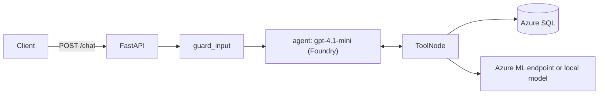
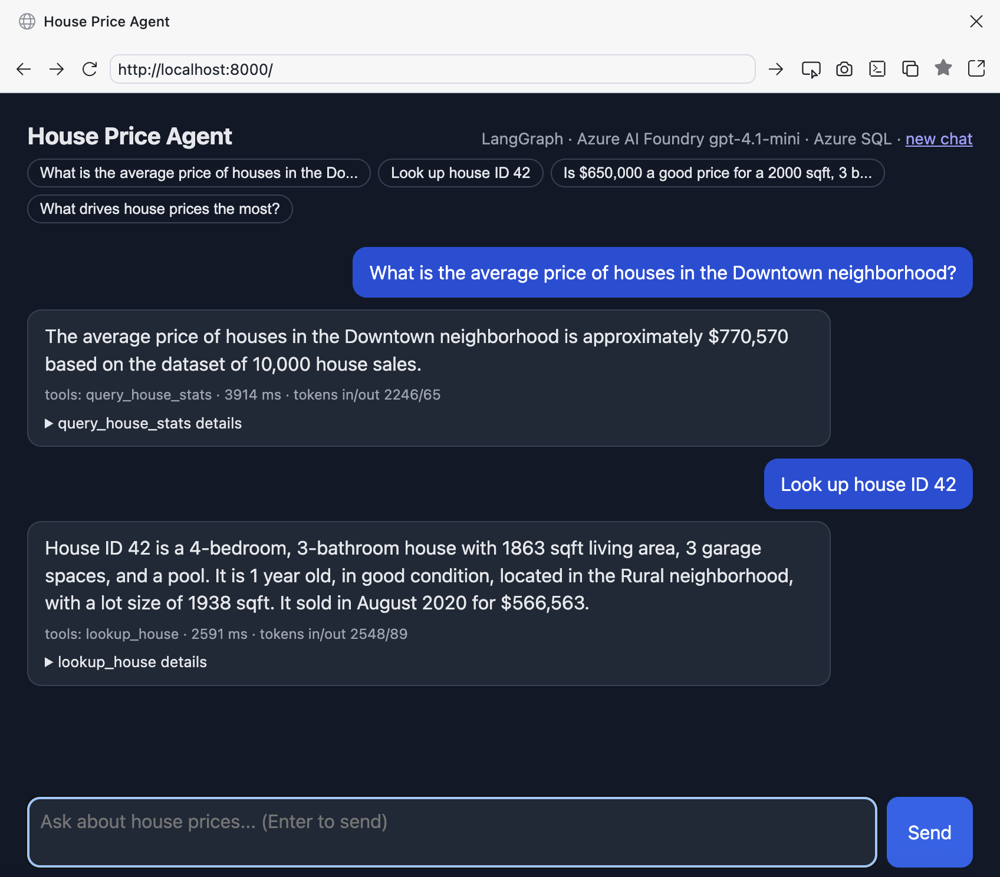
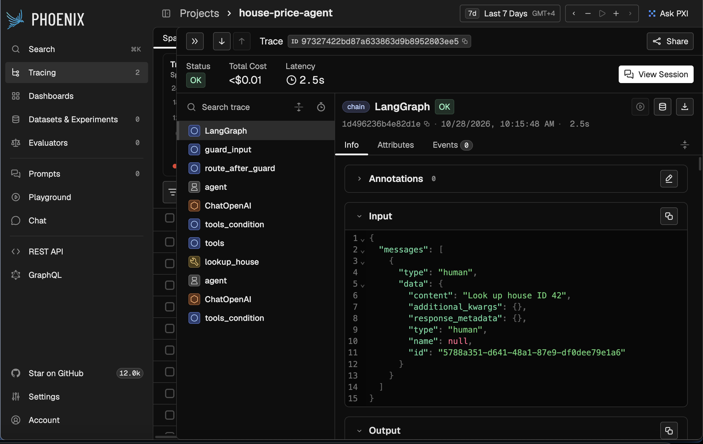
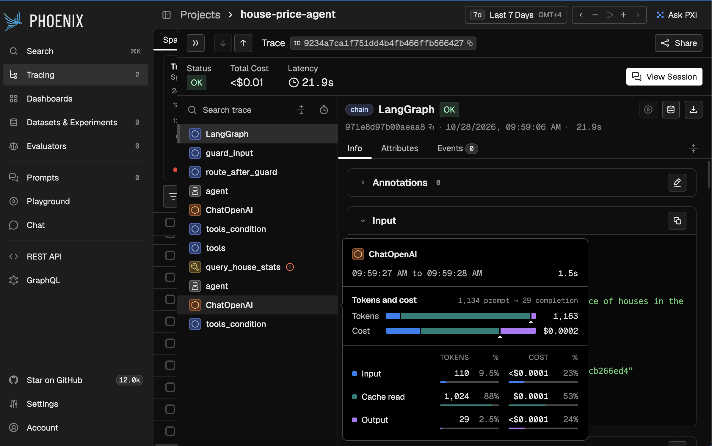
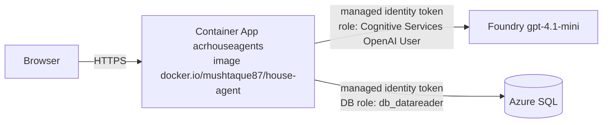

# Azure Multi-Agent Platform: house-price AI agents

An Azure-native, multi-agent AI system built step by step:
- a LangGraph orchestrator talking over **A2A** to specialist agents;
- tools exposed through **MCP** servers;
- Azure AI Foundry (gpt-4.1-mini) as the LLM;
- Azure SQL and the Azure ML model behind the tools;
- Azure AI Search for RAG;
- Azure Container Apps for hosting;
- Arize Phoenix for observability;
- automated evaluation, red-teaming and load testing.

The model and its serving infrastructure come from the companion repo **[ai-mlops](https://github.com/mushtaque87/ai-mlops)**, where the house-price model was trained in Snowflake, served on an Azure ML managed online endpoint, and load tested.

## Progress

| Phase | Status |
|---|---|
| 1. Foundation: resource group, budget, Azure SQL (Entra-only, serverless), Key Vault (RBAC) | Done |
| 2. Single LangGraph agent with direct tools | Done |
| 3. Chat UI and tracing → Azure Container Apps, managed identity | Done |
| 4. Multi-agent over A2A | In progress |
| 5. Evaluation and security baseline | Planned |
| 6. APIM AI gateway | Planned |
| 7. Fine-tuning by distillation | Planned |
| 8. RAG advisor, semantic cache, savings dashboard | Planned |
| 9. Tools refactored into MCP servers | Planned |
| 10. Terraform, CI/CD, ADRs | Planned |

Details, design notes and the Azure resource list: [docs/ROADMAP.md](docs/ROADMAP.md).

## Phase 1 results

- **Data migrated from Snowflake to Azure SQL:** 10,000 rows. The Downtown average is 770,570 in both.
- **No passwords anywhere:**
  - Azure SQL uses Microsoft Entra-only authentication;
  - scripts connect with a short-lived Entra token from `az login`;
  - secrets live in Key Vault, using the RBAC permission model.
- The SQL scripts run in a Linux tools container with ODBC Driver 18 (`infra/docker/tools.Dockerfile`). The agent image will reuse the same driver setup.

```bash
./infra/scripts/run_tools.sh sql_setup.py -s sql-house-agents --load   # create table, load, verify
```

Concept notes for each phase are in [docs/concepts/](docs/concepts/). Guardrail principles: [docs/concepts/guardrails.md](docs/concepts/guardrails.md).

## Phase 2 results: single LangGraph agent



**Tools:**
- `predict_price`
- `explain_prediction`
- `lookup_house` (parameterised SQL)
- `query_house_stats` (text-to-SQL behind a `sqlglot` validator)
- `compare_to_market` (prediction plus similar sales)

**Evaluation:** the same 5 questions used for the Snowflake Cortex Agent, all passing with identical numbers.

| Question | Tool | Answer | Latency |
|---|---|---|---|
| Avg price Downtown | query_house_stats | $770,570 | 4.2 s |
| Houses with a pool | query_house_stats | 5,018 | 2.5 s |
| House ID 42 | lookup_house | $566,563 | 2.6 s |
| Predict Suburban 2000 sqft | predict_price | $522,171 | 3.8 s |
| Predict Downtown 2500 sqft | predict_price | $784,960 | 2.4 s |

**Behaviour checks, all passing:**
- multi-step market comparison;
- follow-up questions using thread memory;
- asks for missing features instead of guessing;
- declines off-topic requests;
- prompt injection blocked before any LLM call (2 ms);
- write requests refused.

**Guard unit tests:** DELETE, UPDATE, DROP, stacked queries, SELECT INTO, `sys.*` tables, `xp_cmdshell` and `OPENROWSET` are all rejected.

A bug found by evaluation and fixed in the guard: the LLM wrote `CAST(AVG(price) AS FLOAT)`. T-SQL averages INT columns with integer division, which gave 770,569. The validator now rewrites every `AVG(x)` to `AVG(CAST(x AS FLOAT))`, a deterministic fix that doesn't depend on the prompt.

```bash
./agent/run_agent.sh                                         # build + run on :8000 (secrets from Key Vault / az)
docker exec -w /srv house-agent python -m tests.test_guards  # guard unit tests
```

Try it with [api/requests.http](api/requests.http).

## Phase 3 results: chat UI and observability

```bash
./agent/run_agent.sh   # agent + chat UI: http://localhost:8000   Phoenix traces: http://localhost:6006
```

**Chat UI.** A single page served by the agent. Each answer shows the tools used, latency, token counts, and an expandable view of each tool's arguments and result.



**Tracing with Arize Phoenix (OpenTelemetry + OpenInference).** Every request is one trace: the LangGraph run, each node (`guard_input`, `agent`, `tools`), each LLM call (prompt, response, tokens, cost) and each tool call (arguments, result, errors).



**Observability catching a real issue.** The trace below took 21.9 s and shows `query_house_stats` failing (red marker): the serverless Azure SQL database was resuming from auto-pause. The fix was retry with backoff on transient SQL errors in `agent/app/db.py`.

The token breakdown also shows **88% of input tokens served from the prompt cache**: the system prompt and tool schemas are an identical prefix on every call, so Azure OpenAI caches them.



**Context and cost controls:**
- trims history to the newest ~6,000 tokens per LLM call, without splitting a tool call from its result;
- 30 questions per conversation;
- `recursion_limit` 12 with a friendly reply when it's reached.

### Deployed to Azure Container Apps: keyless and passwordless



- **No secrets in the app:** no Foundry key, no SQL password. The app's system-assigned managed identity gets Entra tokens at run time.
- **Least privilege:** the identity can only call the model (not read keys or change deployments), and is a `db_datareader` database user, so the database itself refuses writes.
- **Scale to zero:** 0–1 replicas, 0.5 vCPU / 1 GiB.
- **Evaluation on the public URL:** 5/5 with the same answers as local.

Built manually in the portal first, then scripted (idempotent: rerunning against the portal-built setup changes nothing):

```bash
docker buildx build --platform linux/amd64 -t mushtaque87/house-agent:v1 --push agent/
python infra/scripts/aca_deploy.py                                          # env, app, identity, Foundry RBAC
./infra/scripts/run_tools.sh sql_setup.py -s sql-house-agents --reader acrhouseagents   # read-only DB user
```
