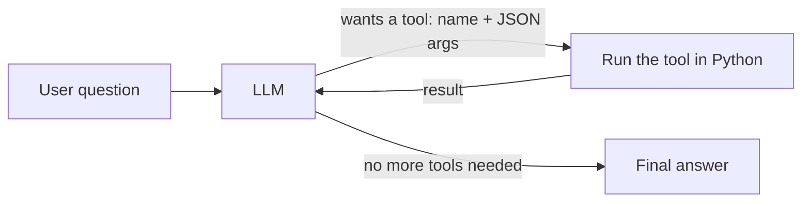
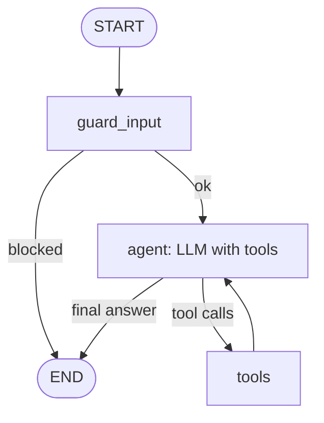

# Phase 2: what an agent is, and how LangGraph builds one

## An agent = LLM + tools + a loop

A plain LLM call is **one question → one answer**. An **agent** lets the LLM *decide actions*:

1. We send the LLM the conversation **plus a list of tools**. Each tool has a name, a description and a JSON schema for its arguments.
2. The LLM either answers directly, or returns a **tool call**, e.g. `predict_price({"sqft": 2000, ...})`. This is **function calling**, built into gpt-4.1-mini.
3. Our code runs the tool and sends the result back to the LLM.
4. Repeat until the LLM answers. This loop is the **ReAct** pattern (Reason + Act).

**The LLM never runs code itself.** It only *asks*. Our code decides whether to run the tool, which is where validation and security live.

## Why tool descriptions matter

The LLM picks tools by reading their **names, descriptions and argument schemas**. A vague description gives wrong tool choices; a precise one ("Use ONLY for one house by its ID") gives correct routing. Tool descriptions are effectively part of the prompt, and the evaluation suite in Phase 4 measures how good they are.

## LangGraph in 5 terms

| Term | Meaning in our agent |
|---|---|
| **State** | The data passed between steps: the list of `messages`, plus `blocked` |
| **Node** | A Python function that reads and updates state: `guard_input`, `agent` (LLM call), `tools` (runs tool calls) |
| **Edge** | Which node runs next |
| **Conditional edge** | A decision: after `agent`, go to `tools` if the LLM asked for one, otherwise finish |
| **Checkpointer** | Saves state per `thread_id`, so a conversation has memory across requests |

Why LangGraph rather than a hand-written while-loop:
- **explicit control flow**: guards, branches, human-approval pauses;
- **built-in memory**;
- **streaming**;
- **graphs that compose**: the Phase 6 multi-agent supervisor is a graph of graphs;
- the same structure shows up in traces.

## Our five tools

| Tool | Backend | Notes |
|---|---|---|
| `predict_price` | Azure ML endpoint if configured, otherwise the same model loaded locally | Pydantic validates ranges *before* any call |
| `explain_prediction` | Model feature importances | Static, no I/O |
| `lookup_house` | Parameterised SQL (`WHERE id = ?`) | No string concatenation, so no SQL injection |
| `query_house_stats` | **LLM-written SQL**, validated by `guards.validate_sql` | SELECT only, one statement, only `dbo.house_prices`, forced `TOP 100` |
| `compare_to_market` | `predict_price` + SQL on similar houses | A multi-step tool |

## Defence in depth for text-to-SQL

1. **Prompt:** the tool description says read-only.
2. **Parser guard:** `sqlglot` parses the SQL; anything except a single SELECT on the allowed table is rejected *before* it reaches the database.
3. **Database permissions:** in Azure, the agent's identity is `db_datareader`, so writes fail even if 1 and 2 were bypassed.

Locally the agent connects with *your* admin token, so layer 3 only applies once it runs as its managed identity (Phase 3).
