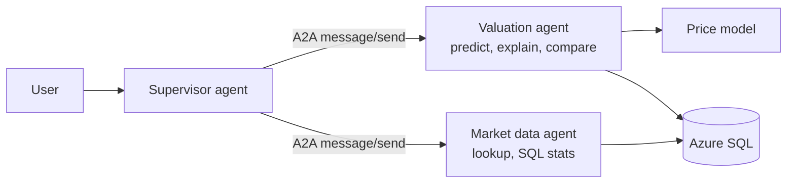

# Phase 4: multi-agent systems and the A2A protocol

## 1. Why more than one agent?

A single agent with many tools works until it doesn't:
- **Tool overload:** with 20+ tools, the LLM picks the wrong one more often, and every tool schema costs tokens on every call.
- **Mixed responsibilities:** one prompt has to carry valuation rules, SQL rules, compliance rules and so on.
- **One team, one deployment:** every change redeploys everything, and every capability shares one identity and one set of permissions.

Splitting into **specialist agents** gives:
- focused prompts and small tool sets, so routing is more accurate;
- **separate identities and permissions per agent** (least privilege per capability);
- independent scaling and deployment;
- different models per agent, e.g. a cheap model for simple specialists.

**The cost:** extra LLM calls (the supervisor plus each specialist), more latency, and distributed debugging. That's why tracing matters even more here.

Interview line: *"Start with one agent. Split when tools, prompts, permissions or team ownership diverge, and measure that routing accuracy and cost are still acceptable."*

## 2. Common multi-agent patterns

| Pattern | How it works | Use when |
|---|---|---|
| **Supervisor (orchestrator–workers)** | A supervisor decides which specialist(s) to call, then combines their answers | Clear specialist domains: **this project** |
| **Router** | One classification step sends the request to exactly one agent; no combining | Simple triage |
| **Hierarchical** | Supervisors of supervisors | Large organisations of agents |
| **Sequential pipeline** | Agent A → B → C, each transforming the output | Document workflows |
| **Network / swarm** | Agents hand off to each other directly | Open-ended collaboration (hard to control and evaluate) |

We use **supervisor with "agents as tools"**: each specialist appears to the supervisor's LLM as a tool, `ask_valuation_agent(request)`. The tool-calling mechanism you already know from Phase 2 is reused for delegation.



## 3. A2A: the Agent2Agent protocol

**A2A** is an open protocol, started by Google and now under the Linux Foundation, for **agents talking to agents** over HTTP, whatever framework each is built with. A LangGraph supervisor can call a specialist written with Semantic Kernel, CrewAI, or anything else that speaks A2A.

### MCP vs A2A

| | MCP | A2A |
|---|---|---|
| Connects | An agent ↔ **tools and data** | An agent ↔ **another agent** |
| The other side is | A deterministic function (run this query) | An autonomous agent with its own LLM, reasoning and memory |
| Unit of work | Tool call | Message / task, possibly long-running |
| Discovery | `tools/list` | **Agent Card** |

They're complementary: specialists use **MCP** for their tools (Phase 9), and the supervisor uses **A2A** for the specialists.

### The pieces we implement

**1. Agent Card:** a JSON document at `/.well-known/agent-card.json`. It's the agent's "business card":

```json
{"name": "valuation-agent", "description": "...", "url": "http://valuation:8000/a2a",
 "protocolVersion": "0.3.0", "capabilities": {"streaming": false},
 "skills": [{"id": "predict_price", "name": "Predict price", "description": "...", "examples": ["..."]}]}
```

The supervisor **reads the cards at startup** and builds its delegation tools from them. Add a new specialist and the supervisor discovers it from its URL; no supervisor code changes.

**2. JSON-RPC 2.0 over HTTP:** the supervisor calls method `message/send`:

```json
{"jsonrpc": "2.0", "id": "1", "method": "message/send",
 "params": {"message": {"role": "user", "messageId": "…", "contextId": "thread-123",
                        "parts": [{"kind": "text", "text": "Predict the price of …"}]}}}
```

The specialist replies with a `Message` (`role: "agent"`, text parts). Our implementation adds its tool calls and token counts in `metadata`, so the supervisor and the UI can show the full route.

**3. contextId:** groups messages into one conversation. The supervisor passes its own thread id, so a specialist can keep its own memory per conversation.

**Not implemented here (worth knowing):**
- **Tasks**, for long-running work with states such as `working`, `input-required` and `completed`;
- **streaming** over Server-Sent Events;
- **push notifications** via webhooks;
- **authentication schemes** declared in the card.

We implement the core `message/send` shapes of A2A v0.3 directly, without an SDK, so every line is visible. The official `a2a-sdk` package provides the same protocol with these extras.

## 4. Context passing: the classic multi-agent bug

A specialist only knows what it is sent. If the user says "What if it had a pool?", forwarding exactly that text to the valuation agent fails, because it doesn't know which house. Two defences:
1. **The supervisor prompt** requires *self-contained* requests that include every detail from the conversation.
2. **contextId memory** in the specialist, as a backup.

## 5. Guardrails across agents

- **Every agent boundary is a trust boundary:** each specialist runs its own input guard on what it receives.
- **Least privilege per agent:** the supervisor has *no* database or model access; only the specialists do. In Azure, each gets its own managed identity.
- **Bounded delegation:** the supervisor's recursion limit caps how many specialist calls one question can trigger.

## 6. Tracing across agents

Each agent sends its traces to Phoenix. The supervisor adds a W3C **`traceparent`** header to every A2A call, and the specialist continues that trace. One user question then appears as **one trace** spanning supervisor → specialist → tool → database. This is called **distributed tracing**, and it's how you debug which agent got it wrong.

## 7. Implementation in this repo

- **One codebase, one image,** run in four roles via `AGENT_ROLE`:
  - `single` (Phase 2/3 behaviour);
  - `supervisor`;
  - `valuation`;
  - `market`.
- `agent/app/agents.py` holds each role's tools and prompt.
- `agent/app/a2a.py` holds the A2A server (Agent Card and `message/send`) and the client used by the supervisor.
- `agent/docker-compose.yml` runs supervisor (8000), valuation (8001), market (8002) and Phoenix (6006).

**Full study guide** (concepts, playbook, file-by-file walkthrough, interview Q&A): [multi-agent-study-guide.md](multi-agent-study-guide.md).
